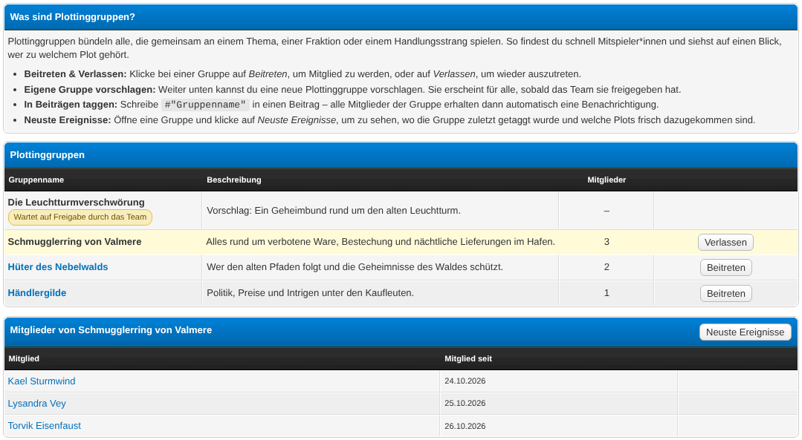
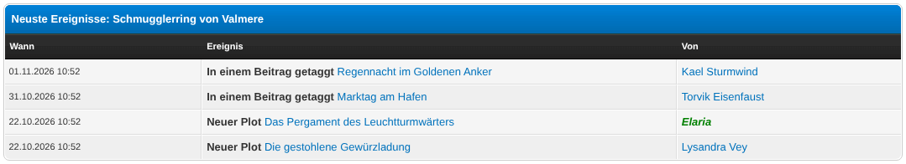
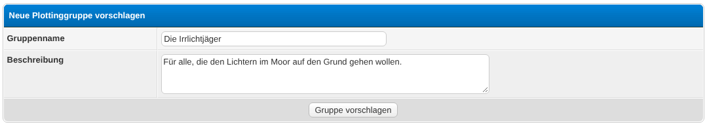
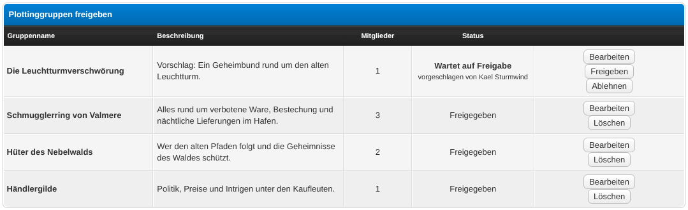
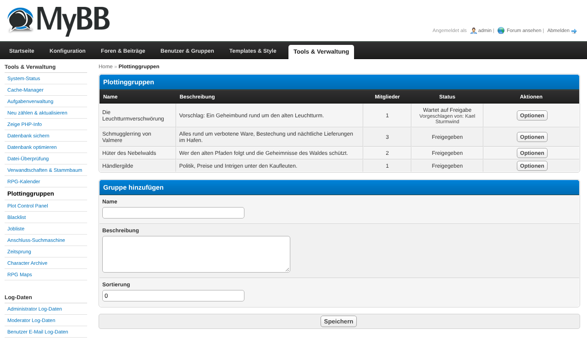

# Plotting Groups (plottinggroups)

A MyBB 1.8 plugin for RPG forums that manages **plotting groups** on their own:
members create, join and leave groups, propose new ones for team approval, and
tag a group inside a post to alert its members. Other plugins – such as the
[Plot Control Panel](https://github.com/pand0rica/plot-cp) – can bind these
groups through a small public API.

## Features

- **Self-service groups**: users join and leave approved groups with one click.
- **Group proposals**: users propose new groups; the team approves, edits or
  rejects them in the **Moderator CP** (with a board-index reminder while
  proposals are waiting).
- **Post tagging**: writing `#"Group name"` in a post alerts every member of that
  group (MyAlerts). Quotes are ignored and edits do not re-alert.
- **Tag autocomplete**: typing `#` in the post editor opens a suggestion dropdown
  and inserts the correct `#"Group name"` tag for you (rich-text and source view).
- **Tag pills**: in the finished post a tag is rendered as a coloured pill that
  links to the group's member list.
- **Member list**: click a group to see its members. The team can add and remove
  members – in the frontend as well as in the ACP – and edit or delete groups
  directly on the groups page.
- **Newest events feed**: a per-group page listing everything that would alert its
  members (tagged posts, and – if the Plot Control Panel is installed – new
  published plots), newest first, each linking to its source.
- **Public API** (`Plottinggroups_Api`) so plot/other plugins can list groups,
  resolve names, collect member uids and validate group ids.
- Migrates existing plotting groups from the Plot Control Panel automatically
  (preserving IDs) on first activation.

## Requirements

- MyBB 1.8.x
- PHP 7.4 or newer (tested up to PHP 8.1)
- **Optional:** [MyAlerts](https://community.mybb.com/mods.php?action=view&pid=avau1249) –
  without it the plugin works normally, just without notifications
- **Optional:** EnhancedAccountSwitcher – only then can the "new group" alert be
  limited to main accounts (see the setting below)

No other dependencies.

## Installation

1. Upload all files to your MyBB root directory (the folder structure matches the
   forum structure): `plottinggroups.php` → forum root; `inc/plugins/...`,
   `admin/modules/tools/plottinggroups.php`, `inc/languages/...` to the matching
   folders.
2. **ACP → Configuration → Plugins** → **Activate** "Plotting Groups". If the
   Plot Control Panel already has groups, they are copied over automatically.
3. **ACP → Configuration → Settings → Plotting Groups** → set the team groups and
   options.

> **Migrating from the Plot Control Panel:** activate **Plotting Groups first**
> (it adopts the existing groups, preserving IDs), then update/reactivate the
> Plot Control Panel – it drops its old group tables and starts using this
> plugin via the API.

## Configuration

| Setting | Meaning |
|---|---|
| **Team groups** | User groups that may approve proposals and manage groups in the ModCP. They also receive proposal alerts. |
| **Allow group proposals** | Users may propose new groups via the frontend form. |
| **Tag forums** | Forums where `#"Group name"` tagging alerts members. |
| **New-group alert: main accounts only** | On: the "new plotting group" alert only reaches main accounts. Off: every account gets it. Needs EnhancedAccountSwitcher – without it every account is a main account and the setting does nothing. |
| **Tag autocomplete** | When on, typing `#` in the post editor opens a dropdown of existing groups and inserts the `#"Group name"` tag for you. |

## Usage

### Groups page (`plottinggroups.php`)

Every approved group is listed with its description and member count. **Join**
and **Leave** are single clicks. Click a group name to see its members (with join
date). The propose form below the list submits a new group for approval.

**Team members** additionally get, without leaving the frontend:

- **Approve**, **Edit** and **Reject** next to every waiting proposal. Approving
  sends the "new group" alert, just like the ModCP does; rejecting deletes the
  proposal.
- **Edit** and **Delete** next to every approved group in the list.
- **Remove** next to each member in the member list, plus an **Add member** field
  below it (enter the exact username).

### Reviewing proposals (team)

**Moderator CP → Plotting Groups**, or via the "new group proposed" alert / the
board-index notice. Per proposal: **Approve** (announces the group to all main
accounts), **Edit**, or **Reject** (deletes it). Approved groups can also be
edited or deleted here. The ACP (**Tools → Plotting Groups**) offers the same
management for admins; groups created there are approved immediately.

### Managing members (team)

Members can be added and removed in three places:

- **Groups page** – open a group's member list: **Remove** per member, **Add
  member** field below the list.
- **ACP → Tools → Plotting Groups** – choose **Manage members** (or **Edit**) in a
  group's options menu; the member list with **Remove** and an **Add member** form
  appears below the group form.
- Users can always join and leave approved groups themselves.

### Tagging a group in a post

Write `#"Group name"` anywhere in a reply or a new thread's first post. When the
post is saved, every member of that (approved) group – except you – receives a
MyAlerts notification linking to the post. You can tag several groups at once.
Tags inside `[quote]` blocks are ignored, and editing a post does not send the
alert again.

With **Tag autocomplete** enabled, you don't have to type the full tag: type `#`
in the editor, keep typing the group name, and a dropdown suggests matching
groups. Pick one with the mouse or the arrow keys + Enter and the correct
`#"Group name"` tag is inserted automatically. Works in the rich-text editor and
the plain-text/source view.

In the finished post the tag is shown as a coloured **pill** linking to the
group's member list, so it stands out from the surrounding text. Only tags that
match an existing, approved group become a pill; anything else stays as plain
text.

### Newest events feed

Open a group's member panel and click **Newest events** in its header. The page
lists the group's events newest first – tagged posts, and (if the Plot Control
Panel is installed) new published plots linked to the group. Each entry links to
its source (the post, the plot). Tagged-post history begins when this version is
activated; plot history is shown retroactively.

### Alerts (MyAlerts)

Each user can toggle these under **User CP → Edit Alert Settings**:

- *A new plotting group is created*
- *A user proposes a new plotting group* (team)
- *One of my plotting groups is tagged in a post*

## For plugin developers

Known consumers of this API: the
[Plot Control Panel](https://github.com/pand0rica/plot-cp) (plots ↔ groups) and
the [Projektbörse](https://github.com/pand0rica/projektboerse) (projects ↔
groups). Keep them in mind when changing `Plottinggroups_Api`.

Guard every call so it degrades when the plugin is absent:

```php
if (function_exists('plottinggroups_load_core')) {
    plottinggroups_load_core();
}
if (class_exists('Plottinggroups_Api')) {
    $groups  = Plottinggroups_Api::approvedGroups();       // gid => name
    $names   = Plottinggroups_Api::groupNames($gids);      // gid => name
    $uids    = Plottinggroups_Api::memberUids($gids);      // recipient uids
    $valid   = Plottinggroups_Api::filterApprovedGids($g); // approved gids
    $url     = Plottinggroups_Api::groupsUrl();

    // push a persistent event into a group's "newest events" feed
    Plottinggroups_Api::logEvent($gid, 'myplugin_thing', $title, $link, $uid);
}
```

### Contributing live events to the feed

To add live-derived events (not stored), hook `plottinggroups_collect_events` and
append raw rows – the feed sanitises and escapes them:

```php
$plugins->add_hook('plottinggroups_collect_events', 'myplugin_pg_events');

function myplugin_pg_events(array &$args): void
{
    // $args['gid'] = the group; append ['type','title','link','uid','dateline'].
    // 'link' must be relative or http(s); malformed rows are dropped silently.
    $args['events'][] = [
        'type'     => 'myplugin_thing',
        'title'    => 'Some title',            // raw text, escaped on render
        'link'     => 'myplugin.php?id=42',
        'uid'      => $some_uid,
        'dateline' => $some_unix_time,
    ];
}
```

Label an event type in the feed with the language key
`plottinggroups_event_type_<type>` (it falls back to the raw slug).

## Screenshots

**Group list with the member panel of a group**



**Newest events of a group (tagged posts and linked plots)**



**Proposing a new group**



**Reviewing proposals in the ModCP**



**ACP group management**



## Uninstallation

1. ACP → Configuration → Plugins → **Deactivate** "Plotting Groups" (removes
   templates, settings, stylesheet, alert types and the template injections).
2. Click **Uninstall** to drop the plugin's database tables. All group data is
   deleted permanently.
3. Delete the uploaded files.

## Changelog

See [CHANGELOG.md](CHANGELOG.md).
